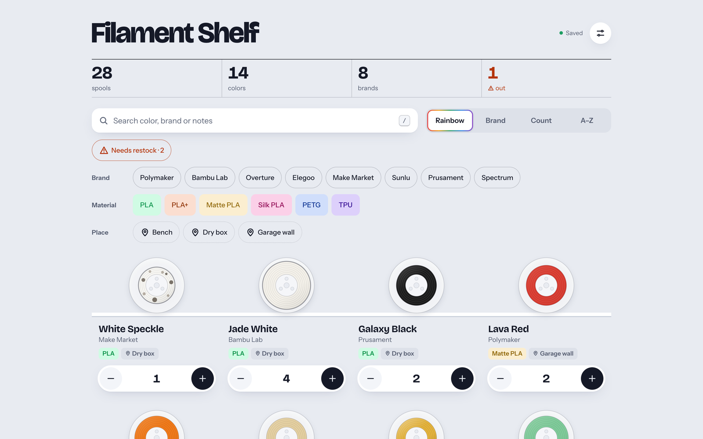
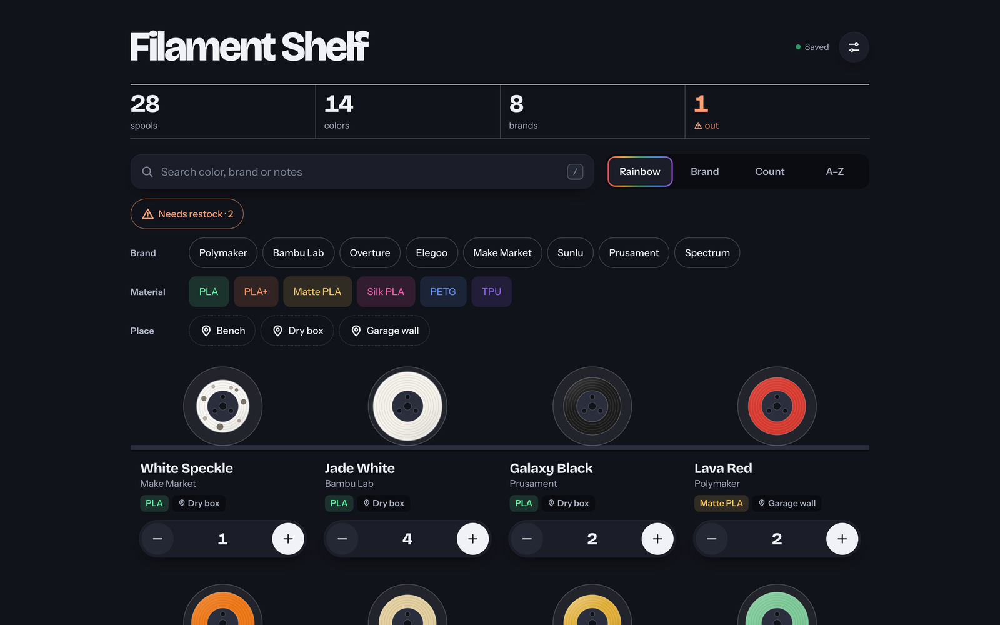
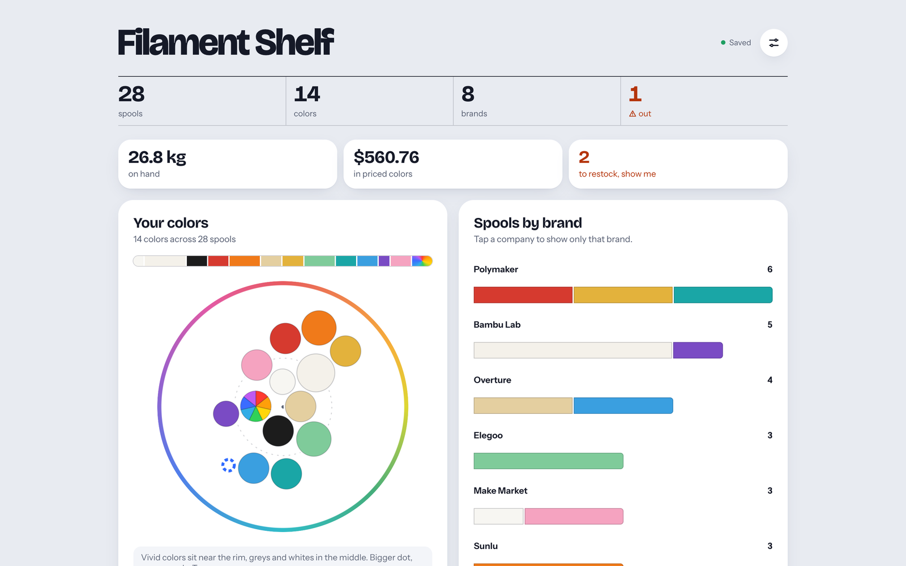
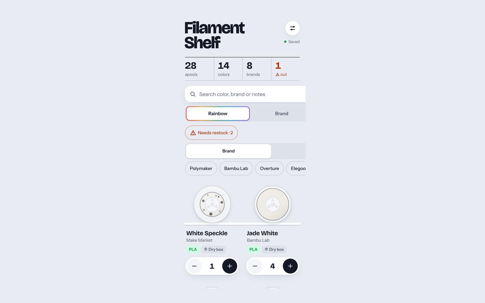
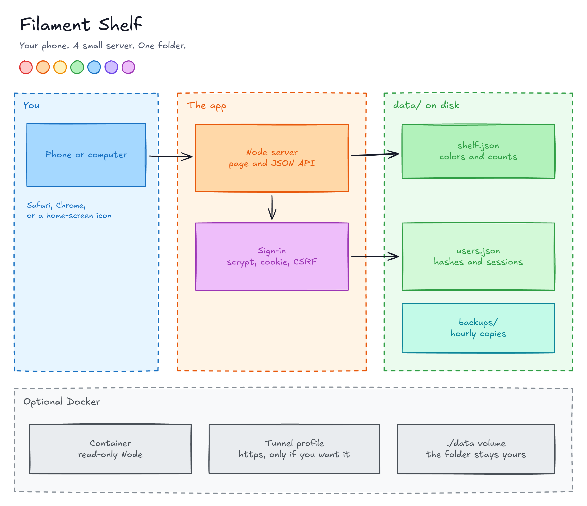

<div align="center">
  <picture>
    <source media="(prefers-color-scheme: dark)" srcset="docs/assets/logo-dark.svg" />
    
  </picture>
  <h1>Filament Shelf</h1>
  <p><strong>A weekend project for the spools in my garage.</strong></p>
  <p>
    <a href="LICENSE"></a>
    <a href="https://github.com/Manaiakalani/filament-shelf/actions/workflows/security.yml"></a>
  </p>
  <p>
    <a href="#in-the-app">Features</a>
    ·
    <a href="#1-start-it">Getting started</a>
  </p>
  
</div>

I wanted a shelf I could open on my phone: which colors I have, how many, and what's left on the open roll. I didn't find anything else without ads, with privacy and security in mind, or that was exactly what I wanted. So I built this.

It runs on a computer you control. The shelf is one folder. Nothing phones home.

The pictures are a made-up shelf, so you can see the layout. A fresh install starts with example spools. Clear examples gets rid of them.

It follows the light or dark setting on your phone.



Insights is the same shelf as charts: what's on hand, what it cost, and a restock list grouped by brand.



On a phone it installs to the home screen.



## How it fits together

Your phone talks to a small Node server. That server is the page and a JSON API. Accounts, sessions, and the shelf sit in `data/` on disk. Docker is optional.



The drawing is also in [docs/diagrams/architecture.excalidraw](docs/diagrams/architecture.excalidraw).

---

## 1. Start it

You need Docker (Docker Desktop on Mac or Windows, or Docker Engine on Linux).

1. Copy `.env.example` to `.env`. Leave the accounts unset if you want to create the first one in the browser.
2. In this folder, run:

   ```sh
   docker compose up -d --build
   ```

3. On your phone (same Wi-Fi), open `http://<your-computer's-IP>:3026`.
   On the computer itself it's `http://localhost:3026`.
   The first visit asks for your name, a username, and a password. After that, sign in with those.
4. Open **Settings**. It shows who is signed in, the low-stock level, and a backup. Use that page before you rely on the shelf.

The port is 3026 unless you change `HOST_PORT` in `.env`.

Stop it with `docker compose down`. It starts again by itself after a reboot. Your shelf stays in the `data/` folder.

To keep it on this computer only, set `BIND_ADDRESS=127.0.0.1` in `.env` before you start it.

## 2. Bring over the shelf from the Claude page

1. In the Claude-hosted Filament Shelf, open **Settings → Export → Backup (JSON) → Copy**.
2. In this one, open **Settings → Import**, paste it, and choose **Replace everything**.

Or save the backup to a file and restore it from the terminal (see Backups).

## 3. Put it on your home screen

**iPhone / iPad:** open it in Safari, sign in, then **Share → Add to Home Screen**. Sign in once inside the home-screen app (iOS keeps its sign-in separate from Safari's).

**Android:** open it in Chrome → menu → **Install app**.

**Computer:** bookmark it, or use the install button in the address bar when the browser offers one.

## 4. Reach it away from home with a Cloudflare Tunnel (optional)

A tunnel gives you a real `https://` address without opening any ports on your router.
You need a free Cloudflare account and a domain on Cloudflare.

1. Cloudflare dashboard → **Zero Trust → Networks → Tunnels → Create a tunnel** → type **Cloudflared**.
   Name it, then copy the **token** (the long string after `--token`).
2. In the tunnel's **Public hostname** tab, add for example `filament.yourdomain.com` with
   service type **HTTP** and URL **`filament-shelf:8080`**.
3. In `.env` set:

   ```
   TUNNEL_TOKEN=<the token>
   TRUST_PROXY=cloudflare
   PUBLIC_ORIGIN=https://filament.yourdomain.com
   BIND_ADDRESS=127.0.0.1
   ```

4. Start with the tunnel:

   ```sh
   docker compose --profile tunnel up -d --build
   ```

   If cloudflared is already running on this machine, skip that command. Copy `docker-compose.override.example.yml` to `docker-compose.override.yml`, point the existing tunnel at `http://filament-shelf:8080`, and set `TRUST_PROXY=cloudflare` and `PUBLIC_ORIGIN`. Run `docker compose` with no `-f`, or Compose skips the override. Do not start a second tunnel.

5. Open `https://filament.yourdomain.com` and add that to your home screen instead.

**Extra lock (recommended):** in Zero Trust → **Access → Applications**, add a self-hosted app for the same hostname with a policy that only allows your email. Cloudflare then asks for a one-time code before anyone even reaches the sign-in page.

Only set `TRUST_PROXY=cloudflare` when the tunnel is in front. Without the tunnel, leave it empty.

## Accounts

The first visit creates the account when `data/users.json` has nobody in it. Set `SETUP_KEY` in `.env` if that address is already reachable past your own Wi-Fi. The setup page asks for the key before it creates the account, then the page closes.

Add someone else, or skip the page and create the account from the terminal, inside the running container:

```sh
docker compose exec app node server/users.mjs add marsh
```

It asks for a password twice. Use at least 8 characters.

| Command | What it does |
|---|---|
| `add <name>` | Add a user |
| `passwd <name>` | Change a password and sign that user out everywhere |
| `signout <name>` | Sign someone out on every device |
| `remove <name>` | Remove a user |
| `list` | List users |

Run each one as `docker compose exec app node server/users.mjs …`.

In the app, **Settings → Account** changes your password and signs out other devices. The device you are using stays signed in. A password change stores a new scrypt hash and drops the other sessions.

Everyone you add sees and edits the same shelf. Other devices pick up a change when you switch back to the app. If two devices edit at once, the second one is asked whether to keep its version or load the other one.

## Backups

Everything lives in `data/`:

- `shelf.json`: the shelf
- `users.json`: accounts and scrypt password hashes
- `sessions.json`: sign-ins, stored as SHA-256 hashes
- `secret.key`: signs the "known device" cookie
- `backups/`: an hourly snapshot while you are editing, newest 72 kept

In the app, **Settings → Export** copies a JSON backup or a CSV spreadsheet. **Import** can replace the shelf or add to it.

Copy the folder:

```sh
cp -R data filament-backup-$(date +%F)
```

Restore a backup file. The tool checks it, saves the current shelf first, and writes the new one:

```sh
docker compose exec -T app node server/restore.mjs < shelf-2026-11-13T09-00-00.json
docker compose restart app
```

Don't copy files into `data/` by hand with `docker cp` while the container is running as root. They can arrive owned by root, and the app then cannot read them. The start script fixes ownership of the `data/` folder itself.

To move to a new computer: copy the whole folder including `data/` and `.env`, then start it there.

## Updating

```sh
docker compose up -d --build
```

`cloudflared` is pinned to a digest in `compose.yaml`. To update it, change that digest on purpose, then run `docker compose --profile tunnel up -d`.

## Settings (`.env`)

| Setting | What it does | Default |
|---|---|---|
| `SETUP_KEY` | Extra key the setup page asks for before it creates the first account. | empty |
| `HOST_PORT` | Port on your computer | `3026` |
| `BIND_ADDRESS` | `0.0.0.0` = your Wi-Fi can reach it; `127.0.0.1` = this computer, or the tunnel | `0.0.0.0` |
| `SESSION_DAYS` | Days a device stays signed in | `30` |
| `COOKIE_SECURE` | Leave empty and the cookie follows the request. `false` forces plain http cookies. | empty |
| `TUNNEL_TOKEN` | Cloudflare Tunnel token. Leave empty when a tunnel is already running. | empty |
| `TRUST_PROXY` | `cloudflare` when a tunnel is in front | empty |
| `PUBLIC_ORIGIN` | Your https address, for example `https://filament.example.com` | empty |

## Checks

```sh
npm ci --prefix app
npm run build --prefix app
node --test
```

GitHub Actions runs those tests and a Trivy scan of the repository (vulnerabilities and secrets).

## In the app

- **Shelf:** search, then filter with the Brand, Material, and Place toggles. On a phone, one of those groups shows at a time. Several brands stay on together. Sort by color, brand, count, or name. Tap a spool to edit it. The stepper changes how many you have. Typing a color name sets the spool color from words in the name, such as red, light blue, or beige, when the current color does not already match. A catalog color or the mixer keeps the shade you picked. Glitter, speckle, and silk show on the spool picture. If two rows are the same brand, material, color, and hex, edit one and combine them.
- **Restock:** colors that are out, or under the open-spool gram warning. One spool is enough, so a single roll is not low. Raise the low-stock level when you want a spare on hand. The list is grouped by brand, and each color keeps its material badge. Each brand can keep a short reorder note and a link. Copy that list when you are about to order. The gram warning defaults to 200 g and can be turned off.
- **Find it in the catalog:** color names, hex values, brands, and materials from the [Open Filament Database](https://github.com/OpenFilamentCollective/open-filament-database) (MIT). The license text is under **Find it in the catalog → Where this comes from**.
- **Open spool:** record grams left on the spool you are printing from. A full spool can stay blank. Insights counts that partial spool, and the picture shows how full a single spool is.
- **Print label:** from a spool, a one-page label with the color, brand, material, place, and grams left.
- **Insights:** kilograms on hand, what the priced colors cost, and charts by color, material, and brand. Tap a company on the brand chart to use the same brand filter. Show every brand clears it.
- **Settings → Account:** who is signed in, a new password, and sign-out for other devices.
- **Export and import:** JSON backup or CSV. A spreadsheet can come back in later, including older files that have no grams-left column.

Shortcuts on a keyboard: `/` search, `N` new spool, `1` and `2` switch tabs, `Esc` closes a sheet.

## Privacy and security

- **Nothing leaves your server.** No analytics and no Google Fonts. Fonts are bundled. The page is locked to load only from your server, and search engines are told not to index it.
- **Passwords:** scrypt (`scrypt$16384$8$1$salt$key`). The password is NFKC-normalized before hashing. The hash is never the password. A check takes the same work whether or not the username exists. At least 8 characters.
- **Wrong passwords** are limited three ways, each over 15 minutes: 10 misses per IP (an IPv6 /64 counts as one), a growing wait after 5 misses for the same username from that IP, and a growing wait after 20 misses on a username from anywhere. A device where you have signed in before carries a signed cookie for a year, so a stranger guessing at your username cannot lock you out of your own phone.
- **Sessions:** random per device, stored only as a SHA-256 hash, `HttpOnly` and `SameSite=Lax`. On https they are `Secure` and use the `__Host-` cookie prefix. They last 30 days unless you change `SESSION_DAYS`.
- **Saves** need the session's CSRF token and must come from your own page. The token is masked differently on every page load. A save is checked with the same rules the app uses, limited to 2 MB, 5,000 spools and 500 brands, and written so a crash cannot leave half a file. An edit that has not reached the server yet stays in that browser tab until it does.
- **Container:** runs as a normal user with a read-only filesystem, no extra Linux privileges, and memory and process limits. The start script is root only long enough to make `data/` writable, then it drops to the `node` user. The server uses Node's built-in modules only. The image removes npm.
- **Your IP address:** with `TRUST_PROXY=cloudflare`, limits use Cloudflare's `CF-Connecting-IP` header. Leave `TRUST_PROXY` empty on plain Wi-Fi. Do not publish port 3026 on your router. Use the tunnel for access away from home.
